# open-tam · SRE Agent

基于 AgentScope + MCP 的多 Agent 排障系统：告警进来，自动查指标、翻日志，产出结构化根因报告；排查过程全程落盘为语料。

核心定位：**把 TAM 的工作显性化**——排查这类隐性经验变成显式、可读、可评测的资产。新 TAM 照着 trace 入职上手，老 TAM 用报告与账本梳理自己的工作，团队沉淀最佳实践。

## 架构总览

```mermaid
flowchart TB
    subgraph 入口层
        CLI[CLI · Typer]
        WH[告警 Webhook<br/>POST /alerts · HMAC 签名验证]
        AD[adapters 多格式适配<br/>cms / alertmanager / native]
        DD[AlertDedup 滑窗去重<br/>默认 300s]
        AR[alert-receiver<br/>AlertEvent 标准化]
        CLI --> AR
        WH --> AD --> DD --> AR
    end

    subgraph 风暴处理
        CORR[AlertCorrelator<br/>时间窗口 + 服务重叠 + 依赖关联聚合]
        PQ[PriorityQueue<br/>P0–P3 优先级 · P0 抢占]
        AR -.风暴场景.-> CORR --> PQ
    end

    subgraph 编排层
        ORC[Orchestrator<br/>手写 ReActLoop<br/>think → act → observe<br/>max_steps + char_budget 双预算]
        SKILL[Skill 注入<br/>按告警名匹配最高置信度模板<br/>拼入 system prompt]
        MA[Metric-Agent]
        LA[Log-Agent]
        KA[K8s-Agent<br/>query_k8s_events / pod_status<br/>node_status / analyze_with_k8sgpt]
        SKILL -.模板.-> ORC
        ORC -- ask_metric_agent --> MA
        ORC -- ask_log_agent --> LA
        ORC -- ask_k8s_agent --> KA
        ORC -- execute_action --> GR
    end

    subgraph 知识层
        EXT[Skill Extractor<br/>从 traces 提取排查模板<br/>+0.1 置信度/条]
        LD[SkillLoader<br/>YAML 存储 · fnmatch 匹配]
        EXT --> LD
        LD -.-> SKILL
    end

    subgraph 护栏与动作层
        GR[Guardrails 引擎<br/>白名单 → 参数校验 → dry-run<br/>→ 敏感操作确认 → 执行]
        AUD[AuditLogger · JSONL 逐条审计]
        PB[PlaybookExecutor<br/>YAML 编排 · on_failure abort/continue/rollback<br/>confidence_threshold 门槛]
        GR --> AUD
        PB --> GR
    end

    subgraph 模型层
        LLM[AgentScope ChatModel<br/>DashScope Qwen 主备切换<br/>FakeChatModel 无 Key 替身]
        JUDGE[EvidenceJudge<br/>LLM-as-Judge 证据充分性 0–1 评分]
        ORC --> LLM
        MA --> LLM
        LA --> LLM
        KA --> LLM
    end

    subgraph MCP 工具总线
        direction LR
        IB[InlineBackend<br/>直连本地 mock 函数]
        MCP[McpStdioBackend<br/>按 metrics_backend / logs_backend<br/>配置路由 mock 或 aliyun]
        MRB[MultiRegionBackend<br/>OPEN_TAM_REGIONS 多区域<br/>并行 fan-out + 错误隔离聚合]
        MM[mock-metrics<br/>mock-logs]
        ALI[aliyun-metrics CMS<br/>aliyun-logs SLS]
        K8S[mock-k8s<br/>K8sGPT 风格 4 工具]
        IB --> MM
        MCP --> MM
        MCP --> ALI
        MCP --> K8S
        MRB -.多区域 fan-out.-> IB
        MRB -.多区域 fan-out.-> MCP
    end

    MA --> IB
    LA --> IB
    KA --> IB

    subgraph 平台层
        DB[(SQLite WAL<br/>users / investigations<br/>alerts / audit_entries)]
        AUTH[AuthMiddleware<br/>X-API-Key / Bearer<br/>admin / operator / viewer]
        NOTI[通知集成<br/>钉钉 / 飞书 / Slack webhook]
        AUTH --> DB
    end

    subgraph 输出层
        REP[reports/*.md 三段式根因报告]
        TRC[traces/*.jsonl 排查语料]
        EVAL[reports/eval-*.md<br/>定位率/关键词命中/平均步数<br/>A/B 对比报告]
        PAT[patrol-*.md 阈值巡检<br/>8 故障模式]
    end

    ORC --> REP
    ORC --> TRC
    MA --> TRC
    LA --> TRC
    KA --> TRC
    ORC -.完成事件.-> NOTI
    TRC -.语料.-> EXT
```



## 功能清单

### M0 · 骨架

| 能力 | 说明 |
|---|---|
| 数据模型 | `AlertEvent`（支持云监控别名自动映射）、`MetricPoint`、`MetricSeries`、`LogRecord`，Pydantic v2 校验 |
| 配置系统 | `Settings` dataclass，环境变量驱动（`DASHSCOPE_API_KEY`、目录路径、模型名、预算参数） |
| CLI 架构 | Typer 多子命令：`metrics` / `logs` / `fault` / `investigate` / `action` / `audit` / `patrol` / `trace` / `version` |
| Demo 服务 | FastAPI `demo_app`：`/health`、`/metrics`、`POST /faults/{name}`、`DELETE /faults/{name}` |

### M1 · 排查闭环

| 能力 | 说明 |
|---|---|
| ReAct 循环 | `orchestrator/loop.py`：think → act → observe 迭代，`max_steps`（默认 15）+ `char_budget`（默认 60K）双预算 |
| 容错设计 | 工具调用异常转 observation 不中断排查，`tool_error` 作为观察继续推理 |
| JSON 提取 | `_extract_json`：`json.JSONDecoder.raw_decode` 逐 `{` 位置尝试，支持 \`\`\`json 代码块和裸 JSON |
| 三段式报告 | `reporting/report.py`：结论摘要 → 异常清单（含已排除项）→ 建议动作 + 排查过程，Markdown 落盘 |
| FakeChatModel | 脚本化模型替身，无 API Key 即可跑通全链路演示与测试 |

### M2 · 多 Agent + 语料

| 能力 | 说明 |
|---|---|
| Orchestrator + 双子 Agent | orchestrator 通过 `ask_metric_agent` / `ask_log_agent` 委托 SpecialistAgent，各自独立 prompt + 工具集 |
| SpecialistAgent | 独立 system prompt、独立工具（`query_metrics` / `query_logs`）、独立 trace，子任务完成后回报 orchestrator |
| MCP 工具总线 | `InlineBackend`（直连）与 `McpStdioBackend`（stdio 子进程）共享同一函数，后端替换零改动 |
| Mock 数据源 | `metrics_data.py`：确定性时序 + 故障窗口 spike；`logs_data.py`：基线日志 + 故障签名 ERROR |
| MCP Server | `metrics_server.py`（FastMCP "mock-metrics"）、`logs_server.py`（FastMCP "mock-logs"），标准 MCP 协议 |
| Trace 语料落盘 | `tracing/trace.py`：每步 alert_received / tool_call / observation / final 逐条 JSONL，按 alert_id 分文件 |

### M3 · 护栏 + 巡检

| 能力 | 说明 |
|---|---|
| Guardrails 引擎 | 白名单校验 → 参数校验（多/缺参数都拒）→ dry-run 预览 → 敏感操作人工确认 → 执行 |
| ActionSpec 注册表 | `clear_fault`（safe）、`restart_service`（safe）、`rollback_release`（sensitive，需确认） |
| Confirmer 协议 | `AutoApprove` / `AutoDeny`（默认失败安全）/ `InteractiveConfirmer` |
| 审计日志 | `AuditLogger`：每个决策（denied / dry_run / executed）逐条 JSONL 落盘 `var/audit.log` |
| GuardrailsBackend | 装饰器模式，`execute_action` 走护栏、其余工具透传，不侵入 ReAct 循环 |
| 故障注入系统 | 4 种故障模式：`cpu_spike` / `slow_query` / `oom` / `connection_pool_exhausted`，`FaultState` JSON 跨进程共享 |
| 阈值巡检 | `patrol.py`：对所有注册故障模式做窗口峰值 vs 阈值检测，产出 Markdown 巡检报告 |
| 定时巡检 | `patrol run`（单次）/ `patrol watch --every-min N`（循环） |

### 模型接入

| 能力 | 说明 |
|---|---|
| AgentScopeChatModel | 封装 DashScope Qwen，主备自动切换（`model_primary` / `model_fallback`） |
| 格式转换 | 消息格式自动转换（dict ↔ Msg/block），工具 schema 自动转 OpenAI function 格式 |
| 环境变量 | `DASHSCOPE_API_KEY`、`OPEN_TAM_MODEL_PRIMARY`（默认 qwen-plus）、`OPEN_TAM_MODEL_FALLBACK`（默认 qwen-turbo）、`OPEN_TAM_MODEL_TIMEOUT`（默认 120s） |

### 工程基建

| 能力 | 说明 |
|---|---|
| CI | GitHub Actions：`uv sync --frozen` → `ruff check .` → `pytest -q` → `open-tam eval --fake --min-hit-rate 0.8` |
| 测试 | 342 passed / 1 skipped，覆盖单测 + 集成 + CLI + 全部里程碑；CI 额外执行 fake 评测质量门 |
| Lint | ruff（E4/E7/E9/F/I/B/UP），target py312 |
| 包管理 | uv + hatchling，`uv.lock` 锁定依赖 |
| GTM 落地页 | `GTM/index.html` 单文件静态页，零构建，可直接部署 |

### M4 · Web UI

| 能力 | 说明 |
|---|---|
| TAM 能力发展门户 | `web/static/index.html` + `workspace.js` / `workspace.css` / `workspace-data.js`：白底蓝色 IBM 风格紧凑工作台（自托管 IBM Plex）。左侧 10 个一级模块、可折叠子菜单与收藏；顶部固定客户切换器、全局搜索、快速新建、AI 助手、通知中心 |
| 今日工作台 | 聚合待办、今日节点、进行中事件、风险客户、作战室、日程值班与最近客户；支持处理、转派、进入客户与发起排查 |
| 任务中心 | 统一任务队列：全部 / 我负责 / 我发起 / 等待内部 / 等待客户 / 即将到期 / 已逾期；创建、认领、转派、催办、提交、验收、关闭 |
| 客户 360° | 5 个虚构客户（H 银行 / D 证券 / L 保险 / P 支付 / S 云），10 个 Tab：总览、生命周期、服务与权益、技术资产、风险与事件、采纳与价值、关系与协同、经营信号、统一时间线、档案与交接；支持阶段推进、客户简报、承诺记录、发起交接 |
| 服务执行 | 架构评审、产品导入、上线闸门、风险登记册、变更、重保、容量、监管日历、版本生命周期、值班、服务质量 11 个队列；记录使用统一 7 段详情骨架 |
| 事件与问题 | 工单、重大事件、升级沟通、RCA、复盘、改进项闭环；作战室作为重大事件进行态，进行中在导航与首页置顶 |
| 协同与经营 | 铁三角、售前承诺移交、产品反馈、伙伴、会议决策、QBR/EBR、VBR、续约信号 8 个队列 |
| 我的成长 | 成长总览（能力雷达）、职业路径、IDP、能力图谱、学习训练、认证、1:1、绩效、证据档案、晋升、带教、工时调休、职业转换 |
| 团队管理 | 团队总览、人员客户分配、能力备份、负载疲劳、质量评估、绩效校准、招聘培养、认证晋升、团队知识资产；Mentor/Admin 可见，服务端二次校验 |
| 知识与工具 | 我的知识库与收藏、69 个方法与 Playbook、19 个模板 Checklist、案例库、标准与规范、产品通告、贡献指南、术语表 |
| 系统设置 | 个人偏好、角色权限、数据源集成、评分规则、通知升级、AI 权限、分享脱敏、保留归档、审计日志（Admin） |
| TAM 手册专题 | 完整书稿 28 章 + 22 个附录 + 19 个模板，全部章节均有独立专题页；书稿 Markdown 服务端渲染，`/api/book` 提供目录与正文，右侧 TOC + 上下篇导航。认证开启时手册需登录阅读（viewer 即可），demo 模式可直接阅读 |
| 实战流程中心 | 从书稿自动生成 69 个可执行流程（28 章节实战 + 22 标准落地 + 19 模板工具）：开始流程、勾选步骤、写备注、保存进度、导出 Markdown；章节页可直接进入关联流程，流程页可回到原文与排查工作台。登录用户服务端保存，demo 本地保存 |
| 能力路径 | 6 个入门模块（告警分级、指标窗口、日志证据、根因报告、护栏、复盘）+ 浏览器本地进度 |
| 案例库 | 12 个案例（8 个可注入故障 + 4 个合成阅读案例），支持分类/搜索、案例详情、一键注入并预填告警 |
| 排查工作台 | SSE 流式时间线 + TAM 五步法 + 快速注入 + fake/transport 选择 + 敏感操作确认 |
| SSE 流式排查 | `POST /api/investigations` 202 受理 → `GET /api/investigations/{id}/events` 流式推送；刷新重连按快照重放不丢事件 |
| InvestigationHub | 内存会话注册表 + 事件广播：TraceRecorder sink 旁路回调（trace JSONL 仍是唯一事实源），线程→asyncio 桥接 |
| 核心复用 | `orchestrator/investigate.py: run_investigation` 排查组装主体，CLI 与 Web 共用同一路径 |
| 子 Agent 区分 | orchestrator / metric / log / k8s 事件按 `agent` 字段区分，观察可折叠展开 |
| 历史与评测 | 排查历史按用户隔离；评测页展示 KPI、趋势与 A/B 对比 |
| 内容目录 | `content/modules.yaml` / `skills.yaml` / `cases.yaml` 可版本化内容，Pydantic 校验后由 `GET /api/catalog` 驱动前端 |
| 学习进度 | 登录用户落库 `learning_progress`，首次登录合并本地 localStorage；未登录仍可本地练习 |
| 案例尝试 | `case_attempts` 关联 investigation；完成后按关键词 rubric 自动评分并更新案例进度 |
| 个人能力摘要 | 能力路径页展示已完成模块/案例、Skill 覆盖和同步身份 |
| 团队看板 | Mentor/Admin 查看成员进度、Skill 覆盖与待评审案例；团队角色与 `team_id` 隔离 |
| 审计与报告 API | `GET /api/audit`（Admin，demo 模式开放）+ `GET /api/history/{id}/report`（报告目录内只读，防路径穿越）；`/api/config` 暴露角色权限与通知/集成状态（不含密钥） |

#### 工作台信息架构

默认只展开“今日工作台”和当前模块；一级模块为：今日工作台、任务中心、客户工作、服务执行、事件与问题、协同与经营、我的成长、团队管理、知识与工具、系统设置。常用页面可收藏，收藏置顶显示。

核心页面采用统一约定：

- **今日工作台**：待办、今日节点、进行中事件、风险客户、作战室、值班与最近客户聚合；动作直接回到来源对象。
- **客户 360°**：顶部固定客户名、阶段、健康度、负责人、最高风险、下一节点；10 个 Tab 不重复左侧目录，风险/事件/经营信号是客户视角的过滤结果。
- **统一详情骨架**：基本信息 → 当前结论 → 执行内容 → 协作信息 → 关联对象 → 时间线 → 关闭标准；任务、服务记录、协同记录、事件均复用。
- **作战室**：重大事件的进行态页面，不建长期台账；进行中时在导航和首页置顶，结束后回到重大事件列表。
- **角色**：团队管理只对 Mentor/Admin 显示，但菜单隐藏不等于授权，服务端仍校验；审计日志仅 Admin。

演示工作区（客户、任务、服务执行、协同、成长目标、绩效与工时）保存在浏览器 `localStorage`；学习进度、案例尝试、流程运行、排查历史、团队与评测走服务端。设置页明确标注这一数据边界，并提供“重置演示数据”。

### M5 · 实盘接入

| 能力 | 说明 |
|---|---|
| 多格式告警适配 | `receiver/adapters.py`：cms（云监控）/ alertmanager / native 自动检测，P1–P4 severity 映射 |
| Webhook 签名验证 | `open-tam serve` 已挂载 `POST /alerts`；HMAC-SHA256 `X-Signature`（`OPEN_TAM_WEBHOOK_SECRET`），滑窗去重（默认 300s，同告警名+服务），去重后直接启动排查 |
| 阿里云 MCP 后端 | `aliyun_metrics_server`（CMS DescribeMetricData）/ `aliyun_logs_server`（SLS）；安装 `uv sync --extra aliyun` 并配置 `OPEN_TAM_ALIYUN_*` 后生效；缺 SDK/凭证会显式报错，不再静默返回零值 |
| 后端路由 | `OPEN_TAM_METRICS_BACKEND` / `OPEN_TAM_LOGS_BACKEND` = `mock` \| `aliyun`，CLI / Webhook / 巡检统一从 `Settings` 注入 |

### M6 · 知识沉淀与 Skill 系统

| 能力 | 说明 |
|---|---|
| trace → Skill | `skill learn` 批量从 traces 提取工具调用序列 + 根因模板，按告警名/服务 fnmatch 聚合，每多一条 trace 置信度 +0.1 |
| Skill 注入 | 排查时按告警名匹配最高置信度模板，拼入 orchestrator system prompt |
| Skill 管理 | YAML 存储：`skill learn / list / show / delete`；支持手写 YAML |
| Web 知识库 | 知识库标签页：GET /api/skills 置信度降序 + 详情懒加载 + 删除（仅 manage_skills 角色）；排查 done 事件提示命中的历史经验（skill_used） |

### M7 · 多租户与生产化

| 能力 | 说明 |
|---|---|
| SQLite 持久化 | WAL 模式 + 版本迁移（`db migrate`）：users / investigations / alerts / audit_entries |
| API Key 认证 | `AuthMiddleware`：`X-API-Key` 或 `Bearer`；角色 admin / operator / viewer（读写/排查/管用户权限集） |
| 通知集成 | 钉钉 / 飞书 / Slack webhook（markdown 消息，fail-soft）：排查完成、动作确认事件；未配置时自动跳过 |
| 历史检索 | `history list / show` 排查历史持久化与查询；Web 端按用户隔离，admin 可见全部 |
| Web 生产化 | 登录遮罩（API Key）+ 排查历史标签页 + 敏感操作 SSE 确认弹窗（WebConfirmer 120s 超时 fail-safe 拒绝，CLI 路径保持 AutoDeny）；确认接口校验角色与归属 |

### M8 · K8s 与基础设施排障

| 能力 | 说明 |
|---|---|
| K8sGPT 风格 MCP（mock） | `k8s_server.py` 四工具：`query_k8s_events` / `query_pod_status` / `query_node_status` / `analyze_with_k8sgpt`；FastMCP 协议兼容，inline 与 `--transport mcp` 均可调用 |
| k8s-agent | 第三子 Agent，与 metric/log-agent 并列；Pod/Node/DNS/证书类问题委托给它 |
| 新故障模式 | `pod_crash_loop` / `node_not_ready` / `dns_failure` / `cert_expiry`（总计 8 种，均带 eval_keywords） |
| 真实集群 | 尚未接入真实 K8s API / K8sGPT 二进制；当前为 mock 演示 |

### M9 · 高级评测与质量闭环

| 能力 | 说明 |
|---|---|
| LLM-as-Judge | `EvidenceJudge` 已接入 eval：fake 用固定评分验证链路，真实模型用独立 LLM 评估证据充分性（0.0–1.0） |
| A/B 模型对比 | `open-tam eval-compare`：多模型 × 故障集对比，Markdown 报告含指标表 + 逐故障明细；默认真实模型，`--fake` 仅验证链路 |
| CI 质量门 | CI workflow 已加入 `open-tam eval --fake --min-hit-rate 0.8`；定位率低于阈值退出码 1 |
| Web 评测标签页 | eval 结果落库 eval_runs（schema v2 迁移）：SVG 趋势折线图 + A/B 对比表 + runs 明细懒加载（GET /api/evals） |

### M10 · 告警风暴与高级编排

| 能力 | 说明 |
|---|---|
| 告警关联聚合 | `AlertCorrelator`：时间窗口 + 服务重叠 + 依赖配置 → AlertGroup；`open-tam storm analyze --alerts-file` 可直接分析一组告警 |
| 优先级排查队列 | `PriorityQueue`（heapq）：P0–P3 分级，P0 抢占 P2；`storm analyze` 输出排查顺序 |
| 修复 Playbook | YAML 定义（敏感度/auto_execute/on_failure=abort\|continue\|rollback/confidence_threshold），经 Guardrails 逐条执行；`open-tam playbook run` 可直接运行 |
| 跨集群/跨区域 | `OPEN_TAM_REGIONS`（逗号分隔）多区域配置：MultiRegionBackend 并行 fan-out query_metrics/query_logs 聚合为 `{"regions": [...]}`，单区域错误隔离，其余工具透传主区域；`fault inject --region` 区域级故障 |

## 产品主页（GTM 落地页）

页面地址：**[GTM/index.html](GTM/index.html)**（`Open TAM` 产品主页，纯静态单文件，零构建，可直接部署 GitHub Pages 等静态托管）

本地预览：

```bash
python3 -m http.server 8643 --directory GTM
# 浏览器打开 http://127.0.0.1:8643/
```

## 文档

- 架构一页纸：[docs/architecture.md](docs/architecture.md)
- MVP 分阶段清单：[docs/mvp-plan.md](docs/mvp-plan.md)
- 设计文档：[docs/superpowers/specs/2026-08-28-sre-agent-design.md](docs/superpowers/specs/2026-08-28-sre-agent-design.md)
- M4 Web UI 设计：[docs/superpowers/specs/2026-08-31-m4-web-ui-design.md](docs/superpowers/specs/2026-08-31-m4-web-ui-design.md)
- M5–M10 路线图设计：[docs/superpowers/specs/2026-09-08-m5-to-m10-roadmap-design.md](docs/superpowers/specs/2026-09-08-m5-to-m10-roadmap-design.md)
- 产品定位与受众：[PRODUCT.md](PRODUCT.md)
- GTM 页面设计系统契约：[DESIGN.md](DESIGN.md)（当前同时记录企业工作台设计系统）

## 当前进展

| 里程碑 | 状态 |
|---|---|
| M0 骨架 | 已完成 |
| M1 排查闭环 | 已完成（DashScope qwen-plus 真实模型验收通过） |
| M2 多 Agent + 语料 | 已完成（orchestrator + metric-agent + log-agent，trace 落盘） |
| M3 护栏 + 巡检 | 已完成（白名单拦截、审计日志、阈值巡检报告、fake 回归） |
| M4 Web UI | 已完成（SSE 流式排查 + 单页聊天界面，浏览器 golden path 验收 + 刷新重放） |
| M5 实盘接入 | 已完成（Webhook 已挂载到 `serve` + 签名/去重；Aliyun 后端需 `--extra aliyun` 与凭证） |
| M6 知识沉淀 | 已完成（trace 提取 Skill + 匹配注入 + CLI 管理 + Web 知识库标签页） |
| M7 多租户与生产化 | 已完成（SQLite 持久化 + API Key 认证 + 通知集成 + Web 登录/历史/敏感操作确认 + 用户级隔离 + team/mentor 角色与团队看板） |
| M8 K8s 排障 | 已完成（mock K8s MCP + k8s-agent + 4 种新故障模式；真实集群未接入） |
| M9 高级评测 | 已完成（生产管线评测 + LLM-as-Judge + A/B 对比 + CI 质量门 + Web 评测标签页） |
| M10 告警风暴与高级编排 | 已完成（关联聚合 + 优先级队列 + Playbook 修复编排 + 跨集群/跨区域排查） |
| 能力发展 P0 | 已完成（YAML 内容目录 + `/api/catalog` + 服务端进度 + 案例尝试评分 + Mentor/Admin 团队看板） |

### 当前限制（生产化前）

- **数据源**：默认 mock；Aliyun CMS/SLS 需要安装 extras、配置凭证，并按环境映射 `service → instanceId`、SLS project/logstore；尚未做真实云端验收。
- **K8s**：K8s MCP 与故障模式均为 mock，未连接真实集群或 K8sGPT 二进制。
- **修复动作**：`clear_fault` 真实生效，`restart_service` / `rollback_release` 仍为模拟动作，未对接真实发布系统。
- **评测**：`eval --fake` 是链路回归，不代表模型效果；真实模型评测需要 `DASHSCOPE_API_KEY`。
- **多租户**：已做用户级 history/SSE/confirm 隔离；组织级租户、配额、登录限流、API Key 轮换/过期尚未实现。
- **能力进度**：登录用户已做服务端同步与团队看板；未登录仍使用浏览器 localStorage。认证、团队与 SSO 仍按现有 API Key + team_id 方案。
- **流程运行**：登录用户的服务端运行记录已落库；demo 本地流程不会自动合并到服务端，团队级流程评审/看板尚未实现。
- **工作台业务对象**：客户、任务、服务执行、协同、成长目标/绩效/工时是本地演示工作区（localStorage），尚未接入 CRM/ITSM/HR 系统；审计 API 已接入 SQLite `audit_entries`，但团队认证申请与绩效校准仍是本地演示记录。
- **作战室**：与排查工作台共用同一条 SSE 排查链路；指挥角色、通报节奏和客户沟通记录目前是工作区记录，未做多人在线协同编辑。
- **部署**：单进程 SQLite + 内存 Hub；多实例、HA、分布式队列尚未覆盖。
- **MCP 性能**：当前每次工具调用启动一个 MCP stdio 子进程，高频真实排查场景需要连接复用/池化。
- **不可信输入**：日志/告警/Skill 内容会进入 LLM 上下文；接入真实修复动作前需增加提示注入防护与执行隔离。

## 快速开始

```bash
uv sync                          # Python 3.12，自动创建 .venv
uv sync --extra aliyun           # 需要真实阿里云 CMS/SLS 时安装
uv run pytest -q                 # 全量测试
uv run ruff check .              # 代码检查（CI 同款）
```

## 无 Key 演示（FakeChatModel 闭环）

```bash
uv run open-tam fault inject cpu_spike
echo '{"alert_name":"CPU使用率过高","service":"demo-app","metric":"cpu_usage","threshold":80,"current_value":92.5}' > /tmp/alert.json
uv run open-tam investigate --alert-file /tmp/alert.json --fake
uv run open-tam fault clear cpu_spike
cat reports/*.md                 # 三段式根因报告
```

## 真实模型排查（DashScope Qwen）

```bash
export DASHSCOPE_API_KEY=sk-...
uv run open-tam investigate --alert-file /tmp/alert.json
```

主备模型可通过 `OPEN_TAM_MODEL_PRIMARY` / `OPEN_TAM_MODEL_FALLBACK` 配置，默认 `qwen-plus` / `qwen-turbo`；单次调用超时秒数用 `OPEN_TAM_MODEL_TIMEOUT` 配置（默认 120）。

## 告警 Webhook 接入

`open-tam serve` 已挂载 `POST /alerts`，支持 CMS / AlertManager / native 三种格式：

```bash
export OPEN_TAM_WEBHOOK_SECRET=change-me
export DASHSCOPE_API_KEY=sk-...
uv run open-tam serve --port 8000

# 签名 = hex(HMAC-SHA256(secret, 原始请求体))
curl -X POST http://127.0.0.1:8000/alerts \
  -H 'Content-Type: application/json' \
  -H "X-Signature: $SIGNATURE" \
  -d '{"alert_name":"CPU使用率过高","service":"demo-app","metric":"cpu_usage","threshold":80,"current_value":92.5}'
```

接收后依次做签名校验 → 格式适配 → 滑窗去重 → 启动排查；重复告警返回 `dedup: true`。

## 关键环境变量

| 变量 | 说明 |
|---|---|
| `OPEN_TAM_METRICS_BACKEND` / `OPEN_TAM_LOGS_BACKEND` | `mock`（默认）或 `aliyun` |
| `OPEN_TAM_ALIYUN_ACCESS_KEY_ID` / `OPEN_TAM_ALIYUN_ACCESS_KEY_SECRET` | Aliyun 凭证（也兼容 `ALIYUN_*`） |
| `OPEN_TAM_ALIYUN_REGION` / `OPEN_TAM_ALIYUN_SLS_PROJECT` / `OPEN_TAM_ALIYUN_SLS_LOGSTORE` | Aliyun 区域与 SLS 配置 |
| `OPEN_TAM_WEBHOOK_SECRET` | Webhook HMAC 密钥；为空时不校验签名 |
| `OPEN_TAM_DEDUP_WINDOW_SECONDS` | 告警去重窗口，默认 300s |
| `OPEN_TAM_AUTH_ENABLED` | Web API Key 认证开关，默认 false |
| `OPEN_TAM_CONTENT_DIR` | 能力目录 YAML 所在目录，默认仓库 `content/` |
| `OPEN_TAM_BOOK_DIR` | TAM 手册目录，默认 `content/tam-book`（含 manuscript / templates） |
| `OPEN_TAM_NOTIFY_DINGTALK_WEBHOOK` / `OPEN_TAM_NOTIFY_FEISHU_WEBHOOK` / `OPEN_TAM_NOTIFY_SLACK_WEBHOOK` | 排查完成/确认通知 |
| `OPEN_TAM_REGIONS` | 逗号分隔的多区域 fan-out，如 `cn-hangzhou,cn-shanghai` |
| `OPEN_TAM_MODEL_TIMEOUT` | 单次模型调用超时秒数，默认 120 |

## 能力目录（content/）

TAM 能力内容与代码一样版本化，启动时由 Pydantic 校验，关系错误会阻止服务启动：

| 文件 | 内容 |
|---|---|
| `content/modules.yaml` | 6 个入门模块：目标、要点、练习入口、关联 Skill |
| `content/skills.yaml` | 8 个 TAM 基础 Skill：分类、等级、适用场景、关联案例 |
| `content/cases.yaml` | 12 个案例：8 个可注入故障 + 4 个合成阅读案例，含证据、根因、建议动作与评分关键词 |
| `content/tam-book/manuscript/` | TAM 手册正文：28 章 + 22 个附录 + 导读/总目录，每篇一个专题页 |
| `content/tam-book/templates/` | 19 个可复用模板与清单，作为手册专题页收录 |

`GET /api/catalog` 统一输出模块/Skill/案例；前端不再硬编码内容。修改 YAML 后重启 `open-tam serve` 生效。

TAM 手册内容为 `2026-10-25` 本地书稿快照；GitHub `the-tam-book` 仓库当前只有 README，完整 manuscript 在本地。更新时按 `content/tam-book/README.md` 同步 manuscript/templates 后重启服务。手册索引搜索覆盖章节标题与摘要，不是全文检索。

### 实战流程

流程目录不单独维护：每个章节/附录的二级标题自动成为步骤，19 个模板同样生成模板流程；章节页会展示相关流程，流程页可回到原文、关联章节和排查工作台。

- `GET /api/workflows`：69 个流程，按定位/能力/工作全景/金融级/AI/成长/标准/工具箱分组
- `GET /api/workflows/{id}`：流程步骤、关联章节、原文链接
- `GET/POST/PATCH/DELETE /api/workflow-runs`：登录用户的运行记录（步骤、备注、状态）
- demo 模式无服务端用户，流程运行保存在 `localStorage`；登录后使用服务端记录

## 评测基线

```bash
uv run open-tam eval --fake                       # 无 Key：脚本回放，验证评测链路
export DASHSCOPE_API_KEY=sk-...
uv run open-tam eval                              # 真实模型：4 种故障 × 1 次
uv run open-tam eval --faults cpu_spike --runs 3  # 指定故障、重复多次
```

报告落盘 `reports/eval-<时间戳>.md`，含根因定位率、关键词命中率、平均步数与耗时。

## 常用命令

| 命令 | 说明 |
|---|---|
| `open-tam metrics query --metric cpu_usage --service demo-app --start <iso> --end <iso>` | 查指标（`--transport mcp` 走 MCP stdio 后端） |
| `open-tam fault inject cpu_spike [--region cn-hangzhou]` / `fault clear cpu_spike` / `fault list` | 故障注入（缺 region 全局生效，指定 region 仅该区域异常） |
| `open-tam investigate --alert-file <json> [--fake] [--transport mcp]` | 排查闭环，报告落盘 `reports/` |
| `open-tam eval [--fake] [--faults a,b] [--runs N]` | 批量评测：根因定位率/关键词命中率/平均步数，结果自动落库 eval_runs（Web 评测标签页展示趋势） |
| `uvicorn demo_app.app:app --port 8000` | 启动被诊断对象 demo-app（`/health` `/metrics` `/faults`） |
| `uv run python -m open_tam.mcp_servers.metrics_server` | 启动 mock-metrics MCP stdio 服务 |
| `open-tam logs query --service demo-app --start <iso> --end <iso> [--level ERROR] [--keyword slow]` | 查日志（双后端同 metrics） |
| `open-tam trace show <alert-id>` | 回放某次排查的 JSONL（含子 Agent 内部步骤） |
| `open-tam action list` | 查看白名单动作注册表 |
| `open-tam action run clear_fault --arg name=cpu_spike` | 执行白名单动作（safe 直接执行） |
| `open-tam action run rollback_release --arg service=demo-app` | 敏感动作：交互确认后执行 |
| `open-tam action run rollback_release --arg service=demo-app --yes` | 敏感动作：跳过确认 |
| `open-tam action run any --dry-run` | dry-run 预览，不实际执行 |
| `open-tam audit show` | 查看审计日志（JSONL） |
| `open-tam patrol run` | 立即巡检一次，产出巡检报告 |
| `open-tam patrol watch --every-min 5` | 每 5 分钟巡检一次（Ctrl-C 退出） |
| `open-tam serve [--host 127.0.0.1] [--port 8000]` | 启动 Web UI（聊天式流式排查），同时挂载 `POST /alerts` 告警入口与 `/health` |
| `open-tam storm analyze --alerts-file <json> [--window-seconds 60]` | 聚合告警风暴并按 P0–P3 输出排查顺序 |
| `open-tam playbook run <yaml> [--dry-run] [--yes]` | 按 YAML 逐条执行修复动作（全部经过 Guardrails） |
| `open-tam skill learn --traces traces/` | 从 trace 语料批量提取排查 Skill |
| `open-tam skill list` / `skill show <name>` / `skill delete <name>` | Skill 管理（YAML 存储） |
| `open-tam team create <name>` / `team list` | 创建/列出团队 |
| `open-tam user create <name> --role admin --team <team-id>` | 创建用户并加入团队（API Key 仅创建时打印一次） |
| `open-tam db migrate` | SQLite 版本迁移 |
| `open-tam history list` / `history show <id>` | 排查历史持久化检索 |
| `open-tam eval-compare --models a,b [--fake]` | A/B 模型对比评测（默认真实模型；`--fake` 仅验证链路） |

## 已知环境注意事项

- macOS + Python 3.12.13+：`.venv` 内 editable `.pth` 若被标记 hidden（`UF_HIDDEN`），Python 会跳过它导致 `open_tam` 不可导入（本环境已观察到周期性复现）。修复：`chflags nohidden .venv/lib/python3.12/site-packages/*.pth`；pytest 已配置 `pythonpath = ["src"]` 不受影响。 彻底规避：`export UV_NO_EDITABLE=1` 后用非 editable 安装（pytest 已配置 `pythonpath = ["src"]` 不受影响）。
- macOS 系统代理：httpx 会读取系统代理，连 loopback 也可能被转发并返回 502。`tests/conftest.py` 已设置 `NO_PROXY=127.0.0.1,localhost`；手动写 httpx 脚本时也建议设置 `NO_PROXY` 或 `trust_env=False`。
